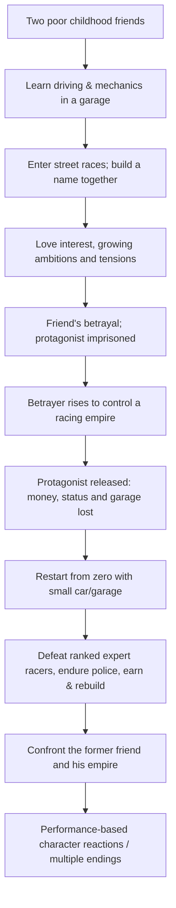

# RISE FROM ZERO
### Open-world story-driven realistic racing game — Design Bible

> **Status:** Pre-production / requirements capture. **Updated:** 12 November 2026.  
> **This is the source of truth for the game vision, not a claim that the game or its code exists.**  
> **Owner's chosen title:** Rise From Zero. Trademark/name availability is not yet cleared.

## What this project is
A large, connected, story-driven open-world street-racing game about **two childhood friends from poverty**, love, ambition, **betrayal**, prison, a lost future, and a difficult return **from zero**. It should feel like driving real cars in a believable world, while preserving player choice *within* a structured career. It combines high-quality cockpit driving, physically credible racing, police pursuits, rival progression, deep car building, a growing garage, and a cinematic story that reacts to performance.

**Target vision (planning estimates, NOT locked requirements):** ~five connected cities; potential world scale ~100–250 km²; possible installed content ~150–300 GB if built to extremely high fidelity; about fifteen rival ranks; multi-year AAA-scale scope. Big download size is *not* a success metric.

## Read the story from start to finish
The complete chronological design is in **[01 — Story Flow](docs/01-STORY-FLOW.md)**. The central through-line is:

**Important:** This visual fixes the **agreed major story beats** only. Exact scene dialogue, city-by-city chapter order, names, betrayal mechanism and ending conditions remain to be authored/approved. Do not pretend placeholders are user-decided canon.

## Core design pillars
1. **Story with continuity:** childhood friendship → garage → rise → betrayal → prison → comeback → confrontation; girlfriend is important from intro/loading onward, guides player, retains feelings, is constrained by the antagonist, secretly helps the return; long and short cutscenes; story responses change by *what player does*, not mid-race Q&A.
2. **Five-city connected world:** Old City, Metro City, Industrial City, Mountain City, Luxury City as *working area names*; traversable highways, villages, alleys, service roads, forests, valleys, lakes, dam roads, bridges, dirt tracks, hidden shortcuts. Scenic geography must meaningfully affect driving and pursuit gameplay.
3. **Realistic car feel:** convincing cockpit per vehicle; functional dashboard, instruments, wheel, mirrors and wipers; credible inertia, tire grip, weight transfer, suspension and jump/landing behavior, collisions and consequences. Multiple camera choices.
4. **Career & rivals:** planning target of **15 rival ranks**. Each rival rank has **five set races**, with **at least three wins** for rank progression; boss encounters require winning their defined challenge races. Experts specify race location, conditions and time. No bypassing progression through money.
5. **Every part has its own progression:** engine, gearbox, nitrous, turbo, body parts, paint, spoilers, hoods, brakes, tires, rims, suspension, lighting and interiors; unlock Basic → Advanced → Pro → Ultimate *with multiple variants within tiers*. Pro and Ultimate engine categories should each have several choices (e.g. 2–3); not one universally available engine/gear/nitrous. At highest appropriate progression, all available customization tiers are unlocked, but parts still need to be purchased and fitted to compatible cars.
6. **Input & freedom:** keyboard / detected gamepad / joystick; remappable controls; automatic or manual transmission; default requested keyboard manual bindings **Left Shift = gear up, Right Shift = gear down** (key mapping and device limitations to test); optional manual clutch, brake and handbrake bindings; per-device settings.
7. **Police & world reaction:** heat, bounty, variable pursuit tactics, pursuit breakers, hotspots, busted outcomes with court/fines/bail/jail where applicable; **career does not restart** when busted. The interrupted race may need replaying.
8. **Economy & garage:** start small; cars, parking capacity, repair and tuning capability expand via earned currency/reputation. Player chooses when to purchase cars or improvements among items already unlocked.
9. **Delivery goal:** a working PC gameplay build culminating in a tested Windows installer / EXE, not merely diagrams, screenshots or code snippets. An error-free guarantee before real QA is not credible.

## Documentation index
| Document | Purpose |
| --- | --- |
| [00 — Vision and rules](docs/00-VISION-AND-RULES.md) | Canon vs proposal, scope and non-negotiables |
| [01 — Story Flow](docs/01-STORY-FLOW.md) | Full chronological storyline and chapters |
| [02 — Story events and endings](docs/02-NARRATIVE-SYSTEM.md) | Performance-driven cinematics and reactions |
| [03 — Career, ranks and races](docs/03-CAREER-RACES.md) | Experts, bosses, five-race rules, scheduling |
| [04 — World & map](docs/04-WORLD-MAP.md) | Five connected city regions and environmental gameplay |
| [05 — Driving physics & cameras](docs/05-DRIVING-PHYSICS.md) | Mechanical realism and first-person immersion |
| [06 — Input & controls](docs/06-CONTROLS.md) | Manual gears, remapping and controller detection |
| [07 — Cars, customizations & garage](docs/07-CARS-CUSTOMIZATION.md) | All individual part tiers, unlocks and economy |
| [08 — Police, heat & busted](docs/08-POLICE-HEAT.md) | Chases, bounty, court/fine/jail pipeline |
| [09 — Tech, data & AGO handoff](docs/09-TECH-AGO-HANDOFF.md) | Architecture candidate, data schemas, agent handoff |
| [10 — Milestones & acceptance](docs/10-BUILD-ROADMAP-QA.md) | Vertical slice, staged delivery, QA checklist |
| [11 — Decisions & unanswered questions](docs/11-DECISIONS-OPEN-QUESTIONS.md) | Keep speculation separate from the owner's words |
| [12 — Requirement traceability](docs/12-REQUIREMENT-TRACEABILITY.md) | Requirement IDs with exact design/test coverage |
| [AGO-readable blueprint](design-data/game-blueprint.yaml) | Machine-readable high-level requirements and explicit unknowns |

## One-page gameplay flow
Start story → unlock an eligible car / garage → receive a specific expert's timed and placed race challenge → travel through the open world → choose permitted tune, paint, gear mode, camera and controls → race with realistic handling, traffic, day/night and police pressure → finish / lose / get busted → resolve results and legal consequences → award cash, bounty and reputation as defined → trigger a short/long reaction scene based on *observed performance* → unlock progression if required races and boss conditions are satisfied → purchase compatible vehicle/part upgrades or expand garage voluntarily → repeat across city regions → face the antagonist and reach a consequence-driven finale.

## Documentation discipline for future implementation (including AGO)
- **Do not delete or silently overwrite product decisions.** Update the decision log and reference which design file changed.
- **Owner-confirmed vs proposed vs TBD** must be labeled. Unresolved mechanics are backlog items, not creative permission to invent canon.
- Build a small vertical slice to validate physics/camera/racing before scaling to an entire five-city world. This does not shrink the ultimate vision.
- Every implemented feature needs source, playable test, regression checks, and a packaged artifact to count as done.
- A functioning AI organization may help delegate development later; **AGO's future game-building capability is not presumed proven**.
- No external branded car models/logos or third-party art/music should be shipped without appropriate rights/licenses.

**Latest design capture:** Game ideas discussed through 12 November 2026, with story details recovered from prior project conversations. If later author notes contradict this snapshot, record the discrepancy before editing canon.
